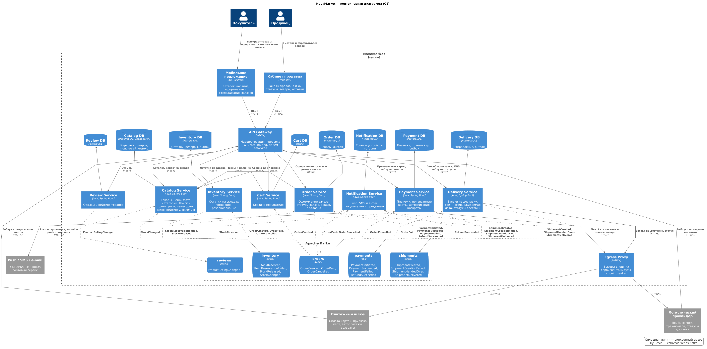
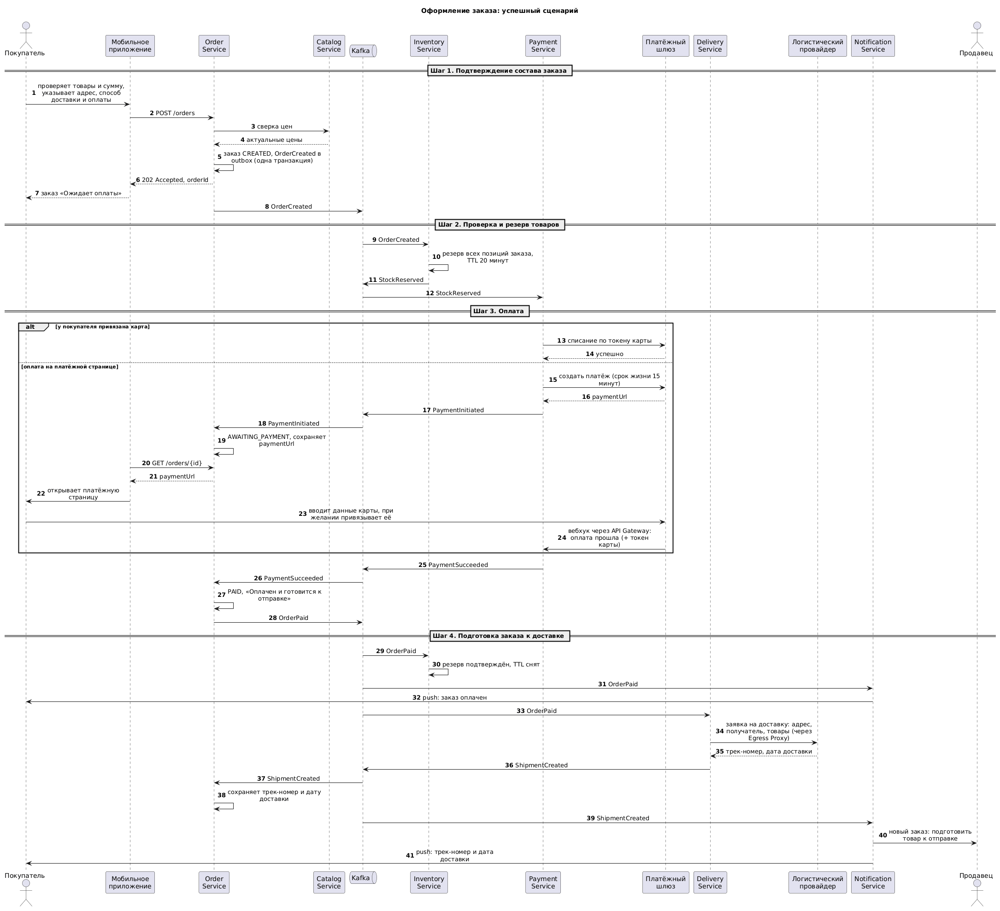
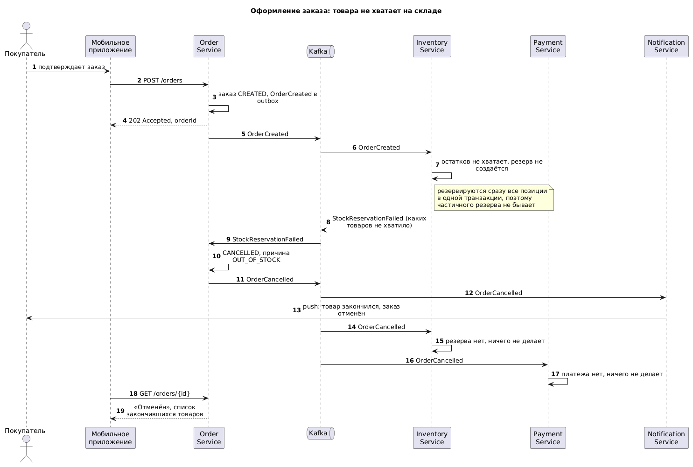
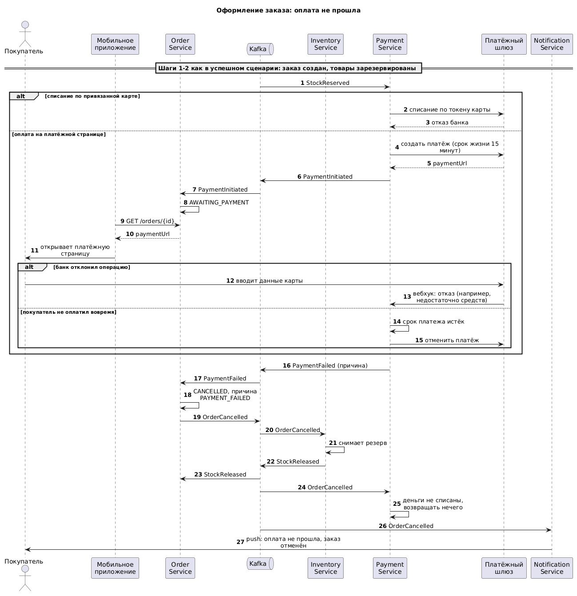
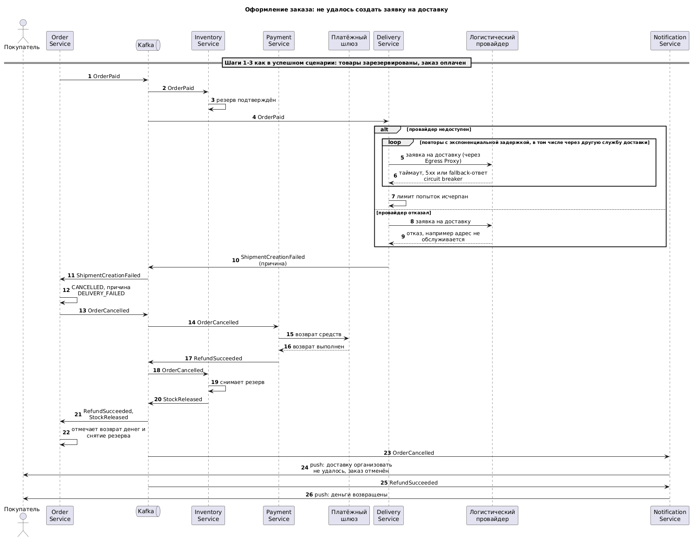

# Задание 1

## Часть 1. C2-диаграмма

Исходник - [containers.puml](containers.puml).

Сервисы:

- API Gateway (NGINX) - вход для мобильного приложения и кабинета продавца, сюда же приходят вебхуки от платежного шлюза и логистов
- Catalog Service - товары, цены, поиск и фильтры (OpenSearch)
- Review Service - отзывы и рейтинг
- Cart Service - корзина (Redis)
- Order Service - заказы и их статусы, заказы продавца
- Inventory Service - остатки и резервирование
- Payment Service - платежи, привязанные карты, возвраты
- Delivery Service - заявки в логистическую службу, трек-номер, статусы доставки
- Notification Service - push, SMS и e-mail покупателям и продавцам
- Egress Proxy (NGINX) - исходящие запросы во внешние сервисы, таймауты и circuit breaker

У каждого сервиса своя БД, события публикуются через transactional outbox, обработчики идемпотентные.

Брокер - Kafka, по топику на сервис-источник (`orders`, `inventory`, `payments`, `shipments`, `reviews`), ключ сообщения - id заказа. Одни и те же события читают несколько сервисов (например, `OrderPaid` нужен Inventory, Delivery и Notification), поэтому топики на схеме вынесены отдельно: стрелка от продюсера идет в топик, а от топика к подписчикам, с перечнем событий, которые они читают.

Кроме событий саги на схеме есть `StockChanged` (наличие товара в каталоге), `ProductRatingChanged` (рейтинг для фильтров), `ShipmentHandedOver` и `ShipmentDelivered`. Статусы заказа ("Ожидает оплаты", "Оплачен и готовится к отправке", "Передан в доставку", "Доставлен", "Отменен") Order Service меняет по событиям оплаты и доставки.

## Часть 2. Saga оформления заказа

Реестр событий - [saga-events.md](saga-events.md).

Хореография: Order Service создает заказ (`OrderCreated`) -> Inventory резервирует товары (`StockReserved`) -> Payment списывает деньги (`PaymentSucceeded`) -> Order публикует `OrderPaid` -> Delivery создает заявку в логистической службе (`ShipmentCreated`), продавцу уходит уведомление.

Если какой-то шаг упал, Order Service отменяет заказ и публикует `OrderCancelled`, а Inventory и Payment по нему снимают резерв и возвращают деньги, если есть что откатывать. Так сервисам не нужно подписываться на ошибки всех шагов.

После оплаты заказ нужно выполнить, поэтому ошибку при создании заявки на доставку Delivery сначала пытается обойти сам (повторы, другая служба доставки), а `ShipmentCreationFailed` отправляет, только если доставить нельзя совсем.

Успешный сценарий:

Товара нет на складе:

Оплата не прошла:

Не удалось создать заявку на доставку:

