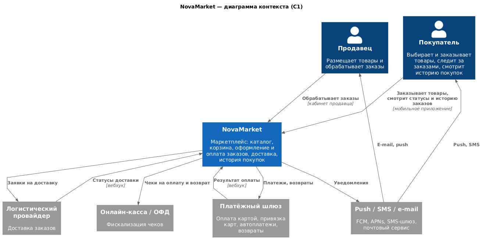
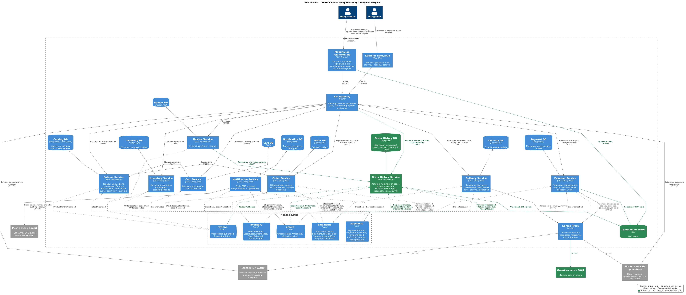

### **Название задачи:** Просмотр истории покупок
### **Автор:** Иван Бусаров
### **Дата:** 28.10.2026
### **Функциональные требования**

|**№**|**Действующие лица или системы**|**Use Case**|**Описание**|
| :-: | :- | :- | :- |
|1|Покупатель, Order History Service|Список заказов|1. Покупатель открывает "Мои заказы". 2. Приложение запрашивает `GET /history/orders`, сервис отдает заказы постранично, новые сверху. 3. По каждому заказу видно дату, сумму, способ доставки и статус.|
|2|Покупатель, Order History Service|Детали заказа|1. Покупатель открывает заказ. 2. `GET /history/orders/{id}` возвращает товары с количеством и ценой, итоговую сумму, способ доставки и оплаты, финальный статус (доставлен или отменен).|
|3|Покупатель, Payment Service, Order History Service, S3|Скачать чек|1. После оплаты Payment Service получает чек из онлайн-кассы, кладет PDF в S3 и публикует `ReceiptIssued`. 2. По кнопке "Скачать чек" Order History Service проверяет, что заказ принадлежит покупателю, и отдает временную ссылку на PDF.|
|4|Покупатель, Review Service, Order History Service|Отзыв о товаре|1. Покупатель нажимает "Оставить отзыв" у товара из доставленного заказа. 2. Review Service проверяет, что товар был куплен, сохраняет отзыв и публикует `ReviewPublished`. 3. В истории у товара появляется отметка, что отзыв оставлен.|
|5|Покупатель, Cart Service, Catalog Service|Заказать снова|1. Приложение передает товары из заказа в Cart Service. 2. Корзина проверяет в каталоге актуальные цены и наличие, дальше обычное оформление заказа.|
|6|Order History Service, Kafka|Обновление истории|1. Сервис читает события заказов, оплат, доставки и отзывов. 2. Обновляет документ заказа, повторные события пропускает.|

### **Нефункциональные требования**

|**№**|**Требование**|
| :-: | :- |
|1|Отклик API истории - до 0,3 с для 98% запросов и до 1 с для 99,99%|
|2|История работает, даже если Order, Payment или Delivery Service недоступны|
|3|Просмотр истории не нагружает сервисы и базы, которые участвуют в оформлении заказа|
|4|Задержка обновления истории в несколько секунд допустима|
|5|Рост до 40 000+ заказов в день (около 15 млн заказов в год), хранилище масштабируется горизонтально|
|6|Покупатель видит только свои заказы, ссылка на чек временная|

### **Решение**

Диаграмма контекста ([context.puml](context.puml)):

Диаграмма контейнеров ([containers.puml](containers.puml)), новое отмечено зеленым:

Выбрал CQRS. Команды (оформление, оплата, отзыв, повтор заказа) остаются в своих сервисах, а для чтения истории добавлен Order History Service со своей MongoDB. Он подписан на события в Kafka и держит готовый к показу документ на каждый заказ, поэтому запрос "мои заказы" - это одно чтение по индексу `customerId + дата`, без похода в другие сервисы. Так отклик укладывается в требования, а история не зависит от сервисов оформления заказа.

Почти все нужные события уже есть из саги, новые только `ReceiptIssued` (Payment Service) и `ReviewPublished` (Review Service).

| Событие | Что попадает в историю |
|---|---|
| `OrderCreated` | дата, товары (название, фото, цена, количество), сумма, способ доставки и оплаты |
| `PaymentSucceeded`, `RefundSucceeded` | оплата (маска карты), возврат |
| `OrderPaid`, `ShipmentHandedOver`, `ShipmentDelivered`, `OrderCancelled` | статус заказа |
| `ShipmentCreated` | трек-номер, ожидаемая дата доставки |
| `ReceiptIssued` | ссылка на чек |
| `ReviewPublished` | отметка, что отзыв оставлен |

Цены и названия в истории - снимок на момент покупки, а при повторе заказа актуальные цены проверяет корзина.

Порядок событий между топиками не гарантирован, поэтому обработчик обновляет только свои поля, документ создается через upsert по `orderId`, статус двигается только вперед, а повторные события отбрасываются по id. Историю по уже существующим заказам при запуске заливаем разово из баз источников.

Почему MongoDB: заказ с товарами, оплатой и доставкой хорошо ложится в один документ, новые поля (возвраты, бонусы) добавляются без миграций, шардируется по `customerId`. PostgreSQL с JSONB тоже подошел бы, но его сложнее масштабировать горизонтально.

`customerId` берется из JWT, ссылка на чек - pre-signed URL на 5 минут.

### **Альтернативы**

API Composition - агрегатор на каждый запрос ходит в Order, Payment, Delivery и Review Service. Просто и без дублирования данных, но отклик упирается в самый медленный сервис, история не открывается, если лежит любой из них, и каждый просмотр нагружает базы оформления заказов. Для MVP сошло бы, для 40 тысяч заказов в день уже нет.

Event Sourcing для Order Service - полный аудит и восстановление состояния заказа на любой момент, но придется переписать хранение заказов, а для чтения все равно нужна проекция, т.е. тот же CQRS. Сложность не окупается.

Отдавать историю прямо из Order Service - не нужен новый сервис, но чтение нагружает базу оформления заказов, а в Order Service попадают чеки и отзывы. Не стал смешивать.

**Недостатки, ограничения, риски**

- Данные в истории обновляются с задержкой, обычно меньше секунды. Только что оформленный заказ приложение показывает из ответа Order Service, а не из истории. Нужен мониторинг consumer lag.
- Еще один сервис и кластер MongoDB, которые надо поддерживать.
- Проекция может разойтись с источниками из-за ошибки в обработчике. Нужна процедура перестройки (Kafka хранит события не вечно, так что через выгрузку из баз) и периодическая сверка с Order Service.
- Изменения схем событий затрагивают несколько команд, нужен Schema Registry с проверкой совместимости.
- Адреса и состав заказов хранятся еще в одной базе, это надо учитывать при удалении данных покупателя.
