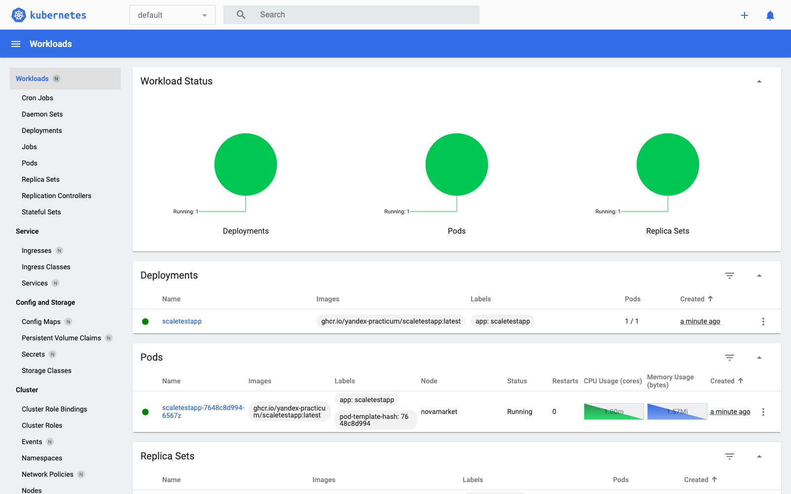
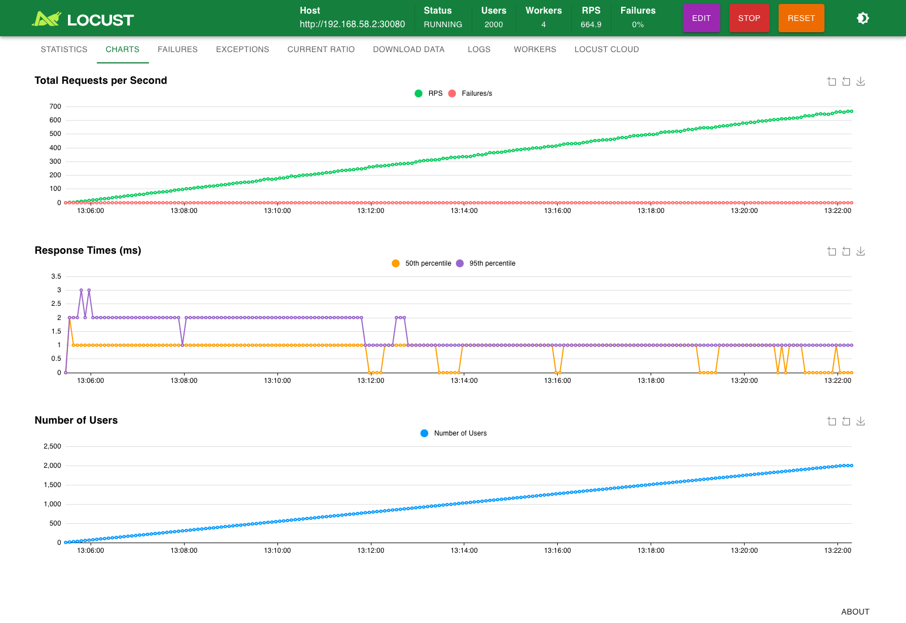
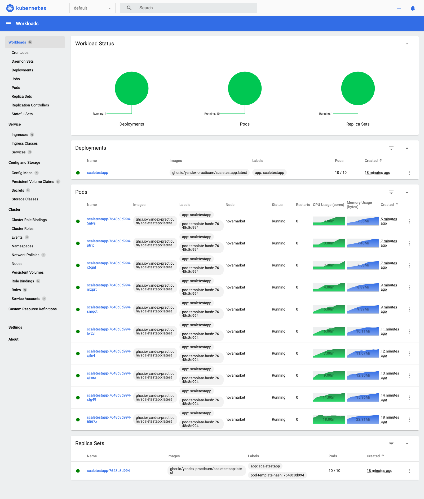
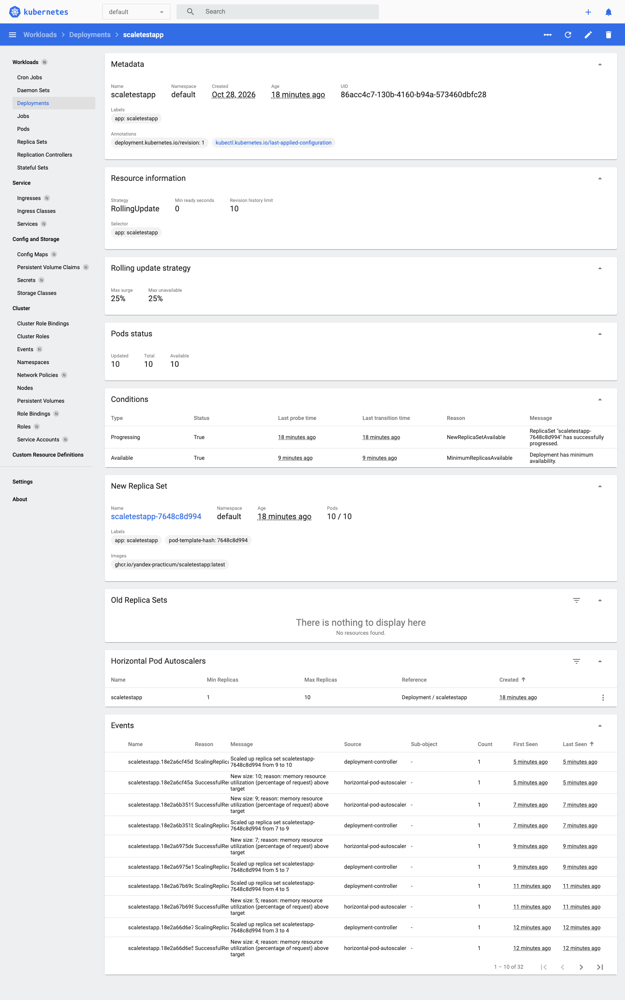
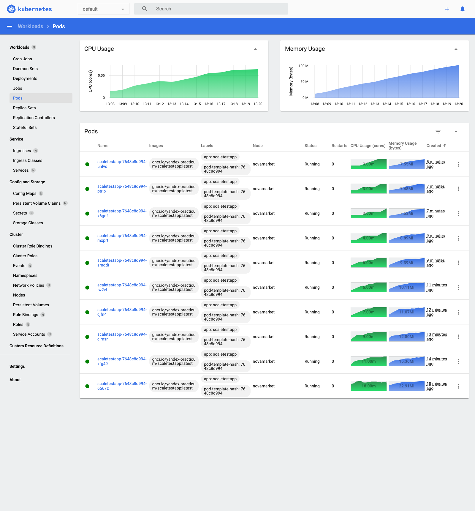

# Задание 3

- `deployment.yaml`, `service.yaml`, `hpa.yaml` - манифесты, HPA по памяти: 80%, от 1 до 10 реплик
- `locustfile.py` - сценарий из задания
- `screenshots/` - дашборд и locust
- `logs/` - вывод kubectl во время теста

## Запуск

```bash
minikube start -p novamarket --driver=podman --container-runtime=containerd --cpus=4 --memory=6g
minikube -p novamarket addons enable metrics-server
minikube -p novamarket addons enable dashboard
kubectl apply -f deployment.yaml -f service.yaml -f hpa.yaml
minikube -p novamarket dashboard
```

Нагрузка - locust, 2000 пользователей, по 2 новых в секунду.

## С чем пришлось повозиться

Образ `ghcr.io/yandex-practicum/scaletestapp:latest` есть только под amd64, а у меня Mac на M-чипе, и под эмуляцией приложение падает с SIGSEGV. Собрал образ из исходников (https://github.com/Yandex-Practicum/scaletestapp) под arm64 с тем же тегом и загрузил в minikube:

```bash
git clone https://github.com/Yandex-Practicum/scaletestapp
docker build -t ghcr.io/yandex-practicum/scaletestapp:latest scaletestapp
docker save ghcr.io/yandex-practicum/scaletestapp:latest -o scaletestapp.tar
minikube -p novamarket image load scaletestapp.tar
```

Поэтому в deployment стоит `imagePullPolicy: IfNotPresent`, иначе kubelet пытается скачать amd64-образ из ghcr.

`minikube service --url` на podman под macOS работает через SSH-туннель, и он отваливался примерно на тысяче пользователей. Поэтому locust запускал в контейнере в сети minikube, и он бил прямо в NodePort. Веб-интерфейс так же на localhost:8089:

```bash
docker run -d --name locust --network novamarket -p 8089:8089 \
  -v "$PWD":/mnt/locust locustio/locust:2.34.0 \
  -f /mnt/locust/locustfile.py --host http://$(minikube -p novamarket ip):30080 --processes 4
```

Про requests: HPA считает проценты от requests, а не от лимита. Сначала поставил `requests: 20Mi`, и не взлетело. Память растет от числа соединений, метрики в minikube обновляются раз в минуту, и пока HPA поднимал вторую реплику, первый под упирался в 30Mi и падал по OOM, а за ним и второй (логи в `logs/requests-20Mi/`). С `requests: 10Mi` реплики добавляются раньше, и до лимита остается запас.

## Результат

| Время | Пользователей | Память, % от requests | Реплик |
|---|---|---|---|
| 13:04 | 0 | 15% | 1 |
| 13:08 | ~320 | 127% | 2 |
| 13:09 | ~440 | 94% | 3 |
| 13:10 | ~560 | 96% | 4 |
| 13:11 | ~680 | 91% | 5 |
| 13:13 | ~920 | 100% | 7 |
| 13:15 | ~1160 | 96% | 9 |
| 13:17 | ~1400 | 90% | 10 |
| 13:22 | 2000 | 113% | 10 (максимум) |

OOM и рестартов не было, в locust 0 ошибок.

До нагрузки:



Locust:



Во время нагрузки, 10 подов:



События HPA в деплойменте:



Память подов:



Заметил, что после остановки нагрузки реплики не уменьшились: через 15 минут память была все еще 84% (`logs/after-load.log`), Go не спешит отдавать память обратно. Для такого приложения, наверное, правильнее масштабироваться по RPS (`http_requests_total`), а не по памяти.
